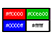
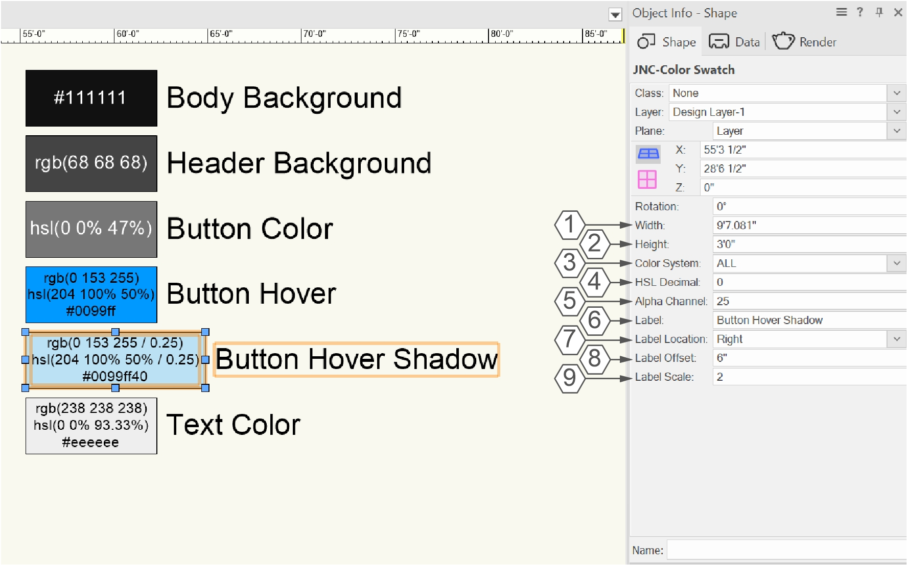
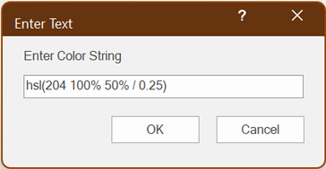
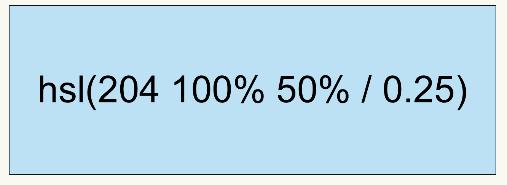
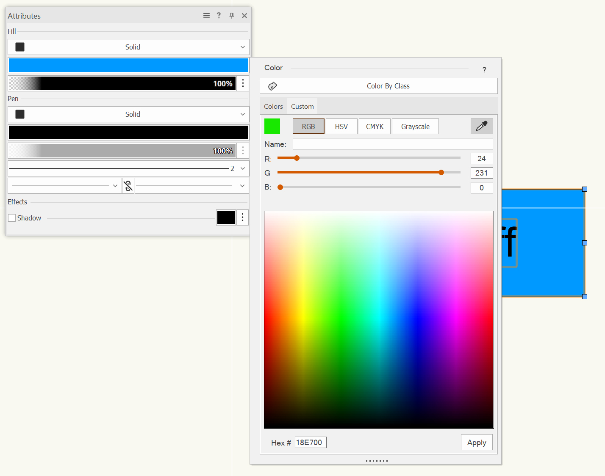
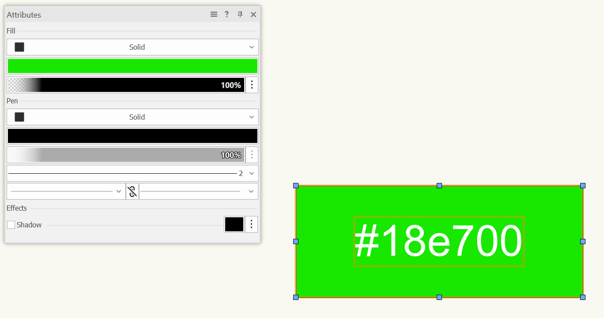

# JNC-Color Swatch

Plug-in Object

## Icon

## Version

**1.0.2** - 10/17/2026

This plug-in is written in Vectorscript (Pascal) and can be used in any version of [Vectorworks](https://www.vectorworks.net) 2019 or newer.

## Description

This tool creates a color swatch that reports its RGB, HSL, or hexidecimal color code values used in graphic design and web development in CSS format.

## Instructions

1. Activate the **Create Color Swatch** tool by clicking on the tool in a Tool Set.
1. Specify the bounds of the swatch by clicking the placement of the upper left corner and lower right corner of the swatch in a manner similar to the Rectangle tool.
1. Pressing and holding the **Ctrl / Command** key while clicking the second point will open a small dialog prompting the User to enter a "Color String" value. The Color String should be formatted similar to CSS. The tool will automatically determine the color system based on the text entered.
1. A label can be added to the swatch by entering text into the **Label** parameter, with different settings to determine the label placement and size.

## Object Info Palette Parameters

1. **Width**: Specifies the width of the Color Swatch.
1. **Height**: Specifies the height of the Color Swatch.
1. **Color System**: Determines which color system is listed on the Color Swatch object. Choices include **RGB**, **HSL**, **Hex**idecimal, or **ALL** three.
1. **HSL Decimal**: Determines how many decimal places are present in HSL listings.
1. **Alpha Channel**: Determines the opacity of the color within the Color Swatch.
1. **Label**: An optional parameter which creates a text label when present.
1. **Label Location**: Determines the location of the Label element. Options include **Top**, **Right**, **Bottom**, and **Left** with **Right** chosen by default.
1. **Label Offset**: Detemines distance between the Color Swatch and the Label element.
1. **Label Scale**: Determines the scale of the Label text relative to the Text setting of the PIO itself.

## Setting the Color of the Swatch

There are three methods of setting the Swatch color.

### 1: Setting Color on Swatch Creation

By holding down the **Ctrl / Command** when using the **Create Color Swatch** tool launch a dialog box asking for a "Color String." This string should be formatted in the same way as a CSS property value.

Open pressing **OK**, a Color Swatch will be created with the matching color, **Color System**, and **Alpha Channel** values. If the given Color String cannot be parsed, a Color Swatch will be created using the current settings in the **Attributes Palette**.

### 2: Changing the Fill Color in the Attributes Palette

The Color Swatch color can be directly changed using the **Attributes Palette**.  This also allows the user to use the eyedropper mode to "pick" the color from an external document.

Once the Fill color has been updated, the text of the Color Swatch will change accordingly.

### 3: Double-Clicking the Color Swatch

If the User would rather change the color using a CSS Color String, double-clicking the object will open the same dialog as setting the color at creation. If the Color String cannot be parsed, the color will remain unchanged.

## Installation Instructions

There are two methods of installation, direct download of the plug-in or through the **JNC Tools Free Manager** plug-in.

### Direct Download:

1. Download source plug-in files:
    1. [Create Color Swatch](Create%20Color%20Swatch.vst) Tool
    1. [JNC-Color Swatch](JNC-Color%20Swatch.vso) PIO
2. Place downloaded files inside the **Vectorworks User Folder** within the **Plug-ins** directory
3. Restart Vectorworks

### JNC Tools Free Manager

1. Run the [**JNC Tools Free Manager**](https://jncogs.github.io/JNC-Tools-Manager-Free/) menu command
2. Select the **Create Color Swatch** tool
3. Press the **Install / Update** button
1. Repeat for the **JNC-Color Swatch** PIO
4. Press **Close** to close the dialog box
5. Restart Vectorworks

## Adding the Plug-in to your Workspace

1. Open the **Workspace Editor** by going to **Tools - Workspaces - Edit Current Workspace**
2. Select the **Menus** tab
3. In the box on the left, find and expand the **JNC** category
4. In the box on the right, find a suitable tool set to place the tool in, such as **Basic** or **Dims / Notes**
5. Click and drag the **Create Color Swatch** tool from the box on the left to the desired tool set in the box on the right
6. Click **OK** to close the editor

## Localization Instructions

The plug-in can be localized to your native language without having access to the source code.  This can be achieved by following the instructions below:

1. Open the **Plug-in Manager** by going to **Tools - Plug-ins - Plug-in Manager**
2. Select the **Third-party Plug-ins** tab
3. Select the **Create Color Swatch** tool or **JNC-Color Swatch** PIO
4. Click the **Customize** button
5. Select the **Strings** tab
6. Double-click a category, such as **Dialog Strings**
7. Select a string to edit and press the **Edit** button
8. Write a new string and press the **OK** button until you are back to the **Plug-in Manager**

The categories for this plug-in are as follows:

- **3000** - *Record Strings*: These strings are for the internal records used when creating or modifying Color Swatches and should not be changed.
- **4000** - *Dialog Strings*: These strings are used in the Color String dialog and can all freely be changed.

## Release Notes

### Create Color Swatch Tool

| Date | Version | Note |
| :---: | :---: | :--- |
| 09/04/2026 | 1.0.0 | Initial release |

### JNC-Color Swatch PIO

| Date | Version | Note |
| :---: | :---: | :--- |
| 09/04/2026 | 1.0.0 | Initial release |
| 09/06/2026 | 1.0.1 | Added ability to scale Label text separately   Added ability to specify number of decimals for HSL color space |
| 10/17/2026 | 1.0.2 | Added ability to double click and enter a new color string |

## Known Bugs

No Known Bugs

## Feature Requests

No current Feature Requests

## License

Copyright (c) Jesse Cogswell (JNC Tools)

Permission is hereby granted, free of charge, to any person or organization
obtaining a copy of this software (the "User") and associated documentation files (the "Software"),
to use, reproduce, distribute, execute, and transmit the Software.

The User is not permitted to modify or attempt to reverse engineer the source code.  The User may
localize the Software using approved methods from within the Vectorworks software.

THE SOFTWARE IS PROVIDED "AS IS", WITHOUT WARRANTY OF ANY KIND, EXPRESS OR
IMPLIED, INCLUDING BUT NOT LIMITED TO THE WARRANTIES OF MERCHANTABILITY,
FITNESS FOR A PARTICULAR PURPOSE, TITLE AND NON-INFRINGEMENT. IN NO EVENT
SHALL THE COPYRIGHT HOLDERS OR ANYONE DISTRIBUTING THE SOFTWARE BE LIABLE
FOR ANY DAMAGES OR OTHER LIABILITY, WHETHER IN CONTRACT, TORT OR OTHERWISE,
ARISING FROM, OUT OF OR IN CONNECTION WITH THE SOFTWARE OR THE USE OR OTHER
DEALINGS IN THE SOFTWARE.